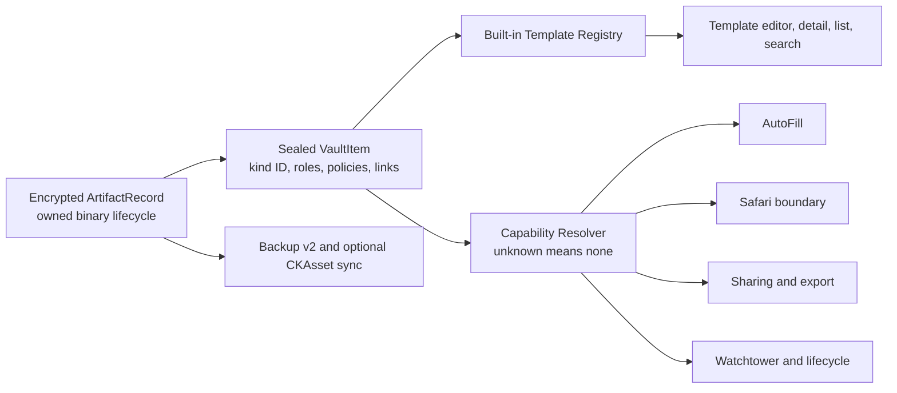

# ADR: Extensible Vault Type Architecture

Status: Proposed  
Date: 2026-08-02

## Context

Vaultify needs many developer-oriented workflows, but its current type identity is a closed Codable
enum and its behavior is inferred from field kind and editable labels. New types must be safe across old
app versions, CloudKit, backup, AutoFill, Safari, sharing, Watchtower, and generic UI.

## Decision

Choose an additive semantic schema over the existing encrypted aggregate:

1. Preserve `ItemCategory` as a legacy/coarse visual fallback during migration.
2. Add optional lossless raw-string `ItemKindID`, `templateVersion`, and `schemaVersion`.
3. Add optional lossless raw-string `FieldRoleID`, separate `sensitivity`, action authorization,
   cryptographic protection, and lifecycle.
4. Use a static, code-reviewed built-in `ItemTemplateRegistry`; definitions are not user-supplied code.
5. Derive all external capabilities through a centralized allowlist resolver. Items do not persist their
   own authority. Unknown template or role receives zero external capability while data remains visible.
6. Model artifact bytes as first-class owned records; do not encode file ownership as a dynamic string field.
7. Use typed item links rather than duplicating a secret across Git, server, database, and key items.

## Alternatives

### A. Add more `ItemCategory` enum cases

Benefit: smallest short-term diff and automatic reuse of current picker/forms.

Rejected because it preserves every root cause: decoder incompatibility, exhaustive switches, flat MVP
UX, label/kind inference, and a polluted coarse browse taxonomy. Suitable only for a rare true top-level
legacy category after a compatibility plan, not for every developer workflow.

### B. Add semantic IDs/roles and a static registry

Selected. It retains encryption/CRUD storage, supports additive JSON migration, provides custom fields,
and creates one policy seam for app/extensions. The cost is a foundation release and temporary legacy
fallback fields that must be carefully tested.

### C. One strongly typed entity/model per vault type

Rejected. It gives compile-time domain safety but duplicates encryption, CRUD, sync, backup, sharing,
search, and UI infrastructure and makes custom fields/unknown future types harder to preserve.

### D. Fully dynamic downloaded/user schema marketplace

Deferred. It requires a validation DSL, signed manifests, trust distribution, localization bundles,
migration rules, capability sandboxing, and anti-phishing design. A static registry solves the known need
without creating a plugin security platform.

## Compatibility Rules

- New IDs and policies are optional fields inside sealed JSON.
- Release A establishes the minimum writer protocol before new semantic creation. Pre-A writable
  downgrade is unsupported because an old Codable writer can erase additive semantics on re-seal.
- New apps infer legacy semantics in memory and write them lazily on a user edit or bounded migration.
- Unknown raw IDs inside a supported schema round-trip. Unsupported future `schemaVersion` is generic
  concealed read-only/recovery; the app preserves original sealed bytes and never typed re-encodes them.
- Authoritative legacy roles are inferred only when provable; labels/position can suggest conversion but
  never grant authority.
- New binary records require a versioned SwiftData/CloudKit schema and separate rollout.
- Feature flags may hide creation/actions but can never disable decode/recovery.

## Security Rules

- Capability = known template allowlist + exact role requirements + field safety policy.
- Registry sensitivity/authorization is a trusted minimum; stored/imported policy may tighten, never relax.
- Unknown template/role: visible and recoverable, but no AutoFill, Safari, default sharing, or export.
- Editable labels, icons, family, and provider presets never grant authority.
- Safari remains identity/card only and gains no command returning developer fields or artifacts.
- Secret/key material export requires explicit action and re-authentication by default.
- UI action authorization and crypto protection are distinct. Level-2 material must be encrypted/wrapped
  by the Level-2 key, not merely hidden behind a biometric screen.

## Template Evolution

- Template and role IDs are append-only.
- `templateVersion` records creation provenance; it never triggers silent mutation.
- Registry retains render/policy support for active versions.
- Required fields are not re-added after user deletion; migrations are explicit and idempotent.
- A version change cannot silently grant a new external capability.

## Consequences

Positive:

- Types gain real workflows without switch explosion.
- Future Mac/CLI integrations can reuse stable semantics.
- Cross-version data is recoverable rather than silently missing.
- Security policies become testable as an exhaustive matrix.

Costs:

- Release A is foundation/hardening rather than visible type count.
- Legacy category/kind and new semantics coexist during migration.
- Artifact v2 is a separate storage/sync/backup project.
- Every built-in template needs localized copy, Polaris assets, validators, actions, and capability tests.

## Rejected Scope

- No remote templates in v1.
- No persisted item-controlled external capability flags.
- No SSH-agent/Git-helper promise in the iPhone app.
- No Secure File release before artifact durability gates.
